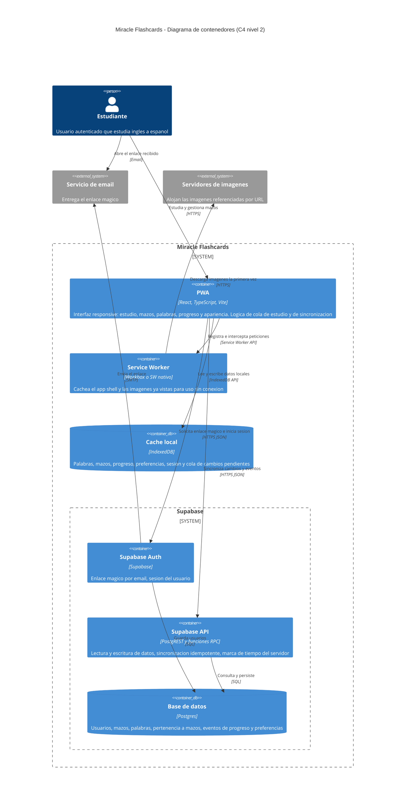
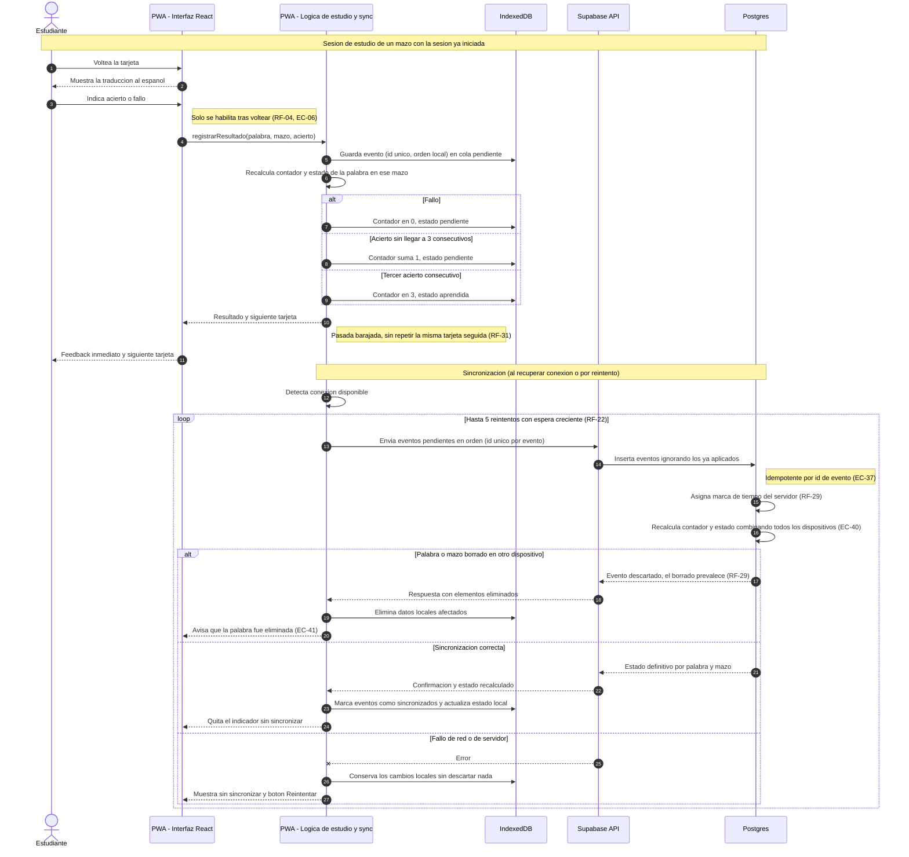

# Miracle Flashcards — Arquitectura (`architecture/architecture.md`)

> Fecha: 2026-10-10. Fuentes: `docs/specs.md` (única fuente de verdad) y `docs/backlog.md`.
> Si este documento contradice `specs.md`, gana `specs.md`. El stack es **tentativo** (specs.md §3) y está sujeto a confirmación.
> No se inventan servicios: cada contenedor sale del stack de `specs.md §3` o de un requisito citado.

## 1. HLD — Modelo C4, nivel de contenedores

### Derivación de contenedores

| Contenedor | Origen en specs.md |
|---|---|
| PWA (React + TypeScript, Vite) | §3 Frontend y PWA; RF-01 a RF-45 (UI, estudio, mazos, progreso, apariencia, animaciones de transición, arrastre y depósito) |
| Service Worker | §3 PWA; RF-14 (caché de imágenes ya vistas), RF-28 (app disponible sin conexión) |
| IndexedDB | §3 Caché local; RF-21, RF-28, RF-41, RF-42 (progreso, edición y sesión sin conexión) |
| Supabase Auth | §3 Backend; RF-09, RF-37 (enlace mágico, 1 h, un solo uso, 60 s entre solicitudes) |
| Supabase API + Postgres | §3 Backend; RF-22, RF-29 (sincronización idempotente, marca de tiempo del servidor, borrado prevalece) |
| Servidor de imágenes externo (sistema externo) | RF-03, RF-15 (la app guarda solo el enlace, no el archivo) |
| Servicio de email (sistema externo) | RF-09 (entrega del enlace mágico; lo envía Supabase Auth) |

### Decisiones y notas

- **Offline-first (RF-28):** la PWA lee y escribe siempre en IndexedDB; la red solo interviene en la sincronización. El Service Worker sirve el app shell y las imágenes ya vistas (RF-14).
- **Sin servicios extra:** no hay servidor propio ni cola de mensajes. La lógica de servidor (idempotencia, marca de tiempo, borrado prevalente) vive en Postgres/RPC dentro de Supabase.
- **Imágenes:** nunca se suben ni se guardan archivos (RF-03). Solo la URL en Postgres; la caché de imagen la mantiene el Service Worker.
- **Seguridad:** los datos son por usuario; el acceso a Postgres se restringe por usuario autenticado (a detallar en el diseño de datos).
- **Fuera de alcance respetado:** sin analítica de terceros, sin IA, sin colaboración en tiempo real, sin apps nativas.

## 2. LLD — Diagrama de secuencia

### Historia elegida: HU-03 + HU-04 + HU-12 (marcar acierto o fallo, aprender la palabra y sincronizar)

Es la más representativa porque atraviesa las tres capas (frontend, API, datos) y concentra las reglas centrales del producto:
acierto/fallo (RF-04 a RF-06), aprendida con 3 aciertos consecutivos por mazo (RF-07, RF-30), uso sin conexión (RF-21, RF-28) y sincronización por eventos ordenados e idempotentes con marca de tiempo del servidor (RF-22, RF-29).

Escenarios cubiertos: HU-03 (acierto suma, fallo reinicia), HU-04 (tercer acierto consecutivo), EC-06 (no calificar antes de voltear), EC-29 y EC-37 (fallo de sincronización y reintento sin duplicados), EC-40 (progreso combinado entre dispositivos).

### Responsabilidades por capa

| Capa | Responsabilidad en este flujo |
|---|---|
| Frontend (PWA) | Voltear, habilitar el resultado solo tras voltear, aplicar la regla del contador y pintar el feedback al instante. Cola de sincronización y reintentos. |
| Datos locales (IndexedDB) | Fuente de lectura durante el estudio; guarda los eventos pendientes para que nada se pierda sin conexión. |
| API (Supabase) | Recibe eventos en orden, garantiza idempotencia, asigna la marca de tiempo del servidor y aplica "el borrado prevalece". |
| Datos remotos (Postgres) | Fuente de verdad para multi-dispositivo; recalcula contador y estado por palabra dentro de cada mazo. |

## 3. Verificación de sintaxis

Los dos bloques se validaron el 2026-10-10 con `@mermaid-js/mermaid-cli` (`npx @mermaid-js/mermaid-cli -i architecture/architecture.md -o salida.md`): 2 diagramas encontrados, 2 renderizados sin errores.
