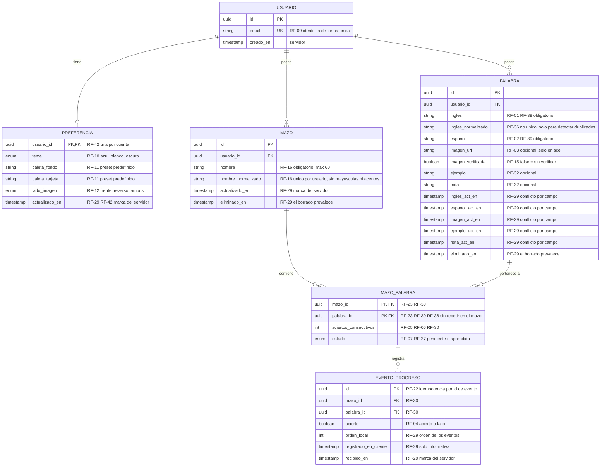

# Miracle Flashcards — Diagrama Entidad-Relación (`architecture/er_diagram.md`)

> Fecha: 2026-10-10. Fuentes: `docs/specs.md` (única fuente de verdad) y `architecture/architecture.md`.
> Si este documento contradice `specs.md`, gana `specs.md`. Modelo **lógico** (sin SQL, sin tipos de motor).
> Criterio: toda entidad, atributo y relación cita un requerimiento (RF-nn) de `specs.md`. No se añade nada que el PRD no justifique.

## 1. Diagrama

## 2. Trazabilidad

### Entidades

| Entidad | Requerimientos | Justificación |
|---|---|---|
| USUARIO | RF-09 | Cuenta identificada de forma única por email (enlace mágico, sin contraseña). |
| PREFERENCIA | RF-10, RF-11, RF-12, RF-42 | Tema, paleta y lado de la imagen se guardan con la cuenta y se sincronizan. |
| MAZO | RF-16, RF-19, RF-24 | Varios mazos por usuario, con nombre único; se editan y borran. |
| PALABRA | RF-01, RF-02, RF-03, RF-08, RF-32, RF-39 | Tarjeta con inglés, español, imagen, ejemplo y nota. Existe con o sin mazo (RF-24, RF-33, RF-34). |
| MAZO_PALABRA | RF-23, RF-30, RF-36, RF-40 | Pertenencia N:M y progreso por palabra dentro de cada mazo. |
| EVENTO_PROGRESO | RF-04, RF-22, RF-29 | Progreso sincronizado como eventos ordenados e idempotentes; contador y estado se recalculan. |

### Relaciones y cardinalidad

| Relación | Cardinalidad | Requerimientos |
|---|---|---|
| USUARIO — PREFERENCIA | 1 a 0..1 | RF-42: una por cuenta; si no hay registro, rige la preferencia del sistema. |
| USUARIO — MAZO | 1 a 0..N | RF-16: la cuenta tiene varios mazos (o ninguno). |
| USUARIO — PALABRA | 1 a 0..N | RF-08: el usuario agrega sus propias palabras. |
| MAZO — MAZO_PALABRA — PALABRA | N a M | RF-23: una palabra en varios mazos; RF-24: puede estar en ninguno. |
| MAZO_PALABRA — EVENTO_PROGRESO | 1 a 0..N | RF-29, RF-30: los eventos de acierto/fallo son por palabra en cada mazo. |

### Reglas de integridad que el modelo debe respetar (para la fase SQL)

| Regla | Requerimiento |
|---|---|
| `email` único; `(usuario_id, nombre_normalizado)` único en MAZO. | RF-09, RF-16 |
| `(mazo_id, palabra_id)` único (clave primaria de MAZO_PALABRA). | RF-36 |
| `ingles_normalizado` **no** es único: al crear solo se avisa. | RF-36 |
| `ingles` y `espanol` no vacíos tras recortar espacios; `nombre` ≤ 60. | RF-16, RF-39 |
| Quitar una palabra de un mazo elimina su fila de MAZO_PALABRA y sus eventos; al reagregarla el contador empieza en 0. | RF-40 |
| Reactivar pone `estado = pendiente` y `aciertos_consecutivos = 0`. | RF-27 |
| `estado = aprendida` cuando `aciertos_consecutivos` llega a 3; un fallo lo reinicia a 0. | RF-05, RF-06, RF-07 |
| Borrar una palabra la elimina de todos los mazos con su progreso; borrar un mazo deja sus palabras sin mazo. | RF-19, RF-24 |
| `eliminado_en` conserva el borrado para que prevalezca ante ediciones o eventos concurrentes. | RF-29 |
| Los EVENTO_PROGRESO sincronizados se conservan; solo se eliminan al quitar la palabra del mazo, al borrarla o al borrar el mazo. | RF-29, RF-40, RF-19 |

## 3. Lo que no es entidad (y por qué)

| Concepto | Motivo |
|---|---|
| Sesión de estudio, pasadas y resumen de sesión | RF-31, RF-35, RF-38: se calculan en tiempo de ejecución a partir de MAZO_PALABRA; specs.md no pide guardar historial de sesiones. |
| Pantalla de progreso (contadores y listas) | RF-26: se deriva de `estado` en MAZO_PALABRA; no se almacena. |
| Panel derecho y sus tres grupos | RF-33, RF-34: se derivan de MAZO_PALABRA (palabras con o sin mazo). |
| Enlace mágico (caducidad, un solo uso, 60 s) | RF-37: lo gestiona Supabase Auth, no el modelo de la aplicación. |
| Cola de cambios pendientes, indicador "sin sincronizar", sesión offline | RF-21, RF-22, RF-41: estado local en IndexedDB, no del modelo de dominio. |
| Imágenes cacheadas | RF-03, RF-14: las guarda el Service Worker; la app solo guarda el enlace. |
| Archivos de imagen, fechas de repaso, dirección español → inglés | Fuera de alcance (specs.md §2). |

## 4. Notas de diseño

- `aciertos_consecutivos` y `estado` son derivables de EVENTO_PROGRESO (RF-29: se recalculan). Se conservan en MAZO_PALABRA porque RF-30 los define por palabra y mazo y el estudio offline (RF-28) los lee directamente.
- Las marcas `*_act_en` por campo de PALABRA existen solo para el conflicto por campo de RF-29.
- `eliminado_en` es una lápida técnica para propagar el borrado entre dispositivos (RF-29). Para el usuario el borrado sigue siendo definitivo (RF-19) y la lápida puede purgarse tras sincronizar.
- Retención de eventos: no se purgan, lo que permite recalcular el progreso (RF-29). Purgarlos sería una decisión nueva que debe registrarse primero en `specs.md`.
- Todas las entidades se filtran por `usuario_id` (directo o vía MAZO/PALABRA); la política de acceso se detalla en la fase SQL.
