# Miracle Flashcards — Diagrama Entidad-Relación (`architecture/er_diagram.md`)

> Fecha: 2026-10-10; nomenclatura actualizada a inglés el 2026-10-11 (D-05 y D-11 de `docs/frontend-specs.md`). Fuentes: `docs/specs.md` (única fuente de verdad) y `architecture/architecture.md`.
> Si este documento contradice `specs.md`, gana `specs.md`. Modelo **lógico** (sin SQL, sin tipos de motor).
> Criterio: toda entidad, atributo y relación cita un requerimiento (RF-nn) de `specs.md`. No se añade nada que el PRD no justifique.
> Los nombres de entidades y campos van en inglés; las descripciones, en español. Equivalencias con la versión anterior en `docs/frontend-specs.md` §4.1.

## 1. Diagrama

```mermaid
erDiagram
    USER ||--o| PREFERENCE : "has"
    USER ||--o{ DECK : "owns"
    USER ||--o{ WORD : "owns"
    DECK ||--o{ DECK_WORD : "contains"
    WORD ||--o{ DECK_WORD : "belongs to"
    DECK_WORD ||--o{ PROGRESS_EVENT : "records"

    USER {
        uuid id PK
        string email UK "RF-09 identifica de forma unica"
        timestamp created_at "servidor"
    }

    PREFERENCE {
        uuid user_id PK, FK "RF-42 una por cuenta"
        enum theme "RF-10 blue, white, dark"
        string background_palette "RF-11 preset predefinido"
        string card_palette "RF-11 preset predefinido"
        enum image_side "RF-12 front, back, both"
        timestamp updated_at "RF-29 RF-42 marca del servidor"
    }

    DECK {
        uuid id PK
        uuid user_id FK
        string name "RF-16 obligatorio, max 60"
        string normalized_name "RF-16 unico por usuario, sin mayusculas ni acentos"
        timestamp updated_at "RF-29 marca del servidor"
        timestamp deleted_at "RF-29 el borrado prevalece"
    }

    WORD {
        uuid id PK
        uuid user_id FK
        string english "RF-01 RF-39 obligatorio"
        string normalized_english "RF-36 no unico, solo para detectar duplicados"
        string spanish "RF-02 RF-39 obligatorio"
        string image_url "RF-03 opcional, solo enlace"
        boolean image_verified "RF-15 false = sin verificar"
        string example "RF-32 opcional"
        string note "RF-32 opcional"
        timestamp english_updated_at "RF-29 conflicto por campo"
        timestamp spanish_updated_at "RF-29 conflicto por campo"
        timestamp image_updated_at "RF-29 conflicto por campo"
        timestamp example_updated_at "RF-29 conflicto por campo"
        timestamp note_updated_at "RF-29 conflicto por campo"
        timestamp deleted_at "RF-29 el borrado prevalece"
    }

    DECK_WORD {
        uuid deck_id PK, FK "RF-23 RF-30"
        uuid word_id PK, FK "RF-23 RF-30 RF-36 sin repetir en el mazo"
        int consecutive_hits "RF-05 RF-06 RF-30"
        enum status "RF-07 RF-27 pending o learned"
    }

    PROGRESS_EVENT {
        uuid id PK "RF-22 idempotencia por id de evento"
        uuid deck_id FK "RF-30"
        uuid word_id FK "RF-30"
        boolean hit "RF-04 acierto o fallo"
        int local_order "RF-29 orden de los eventos"
        timestamp recorded_at_client "RF-29 solo informativa"
        timestamp received_at "RF-29 marca del servidor"
    }
```

## 2. Trazabilidad

### Entidades

| Entidad | Requerimientos | Justificación |
|---|---|---|
| USER | RF-09 | Cuenta identificada de forma única por email (enlace mágico, sin contraseña). |
| PREFERENCE | RF-10, RF-11, RF-12, RF-42 | Tema, paleta y lado de la imagen se guardan con la cuenta y se sincronizan. |
| DECK | RF-16, RF-19, RF-24 | Varios mazos por usuario, con nombre único; se editan y borran. |
| WORD | RF-01, RF-02, RF-03, RF-08, RF-32, RF-39 | Tarjeta con inglés, español, imagen, ejemplo y nota. Existe con o sin mazo (RF-24, RF-33, RF-34). |
| DECK_WORD | RF-23, RF-30, RF-36, RF-40 | Pertenencia N:M y progreso por palabra dentro de cada mazo. |
| PROGRESS_EVENT | RF-04, RF-22, RF-29 | Progreso sincronizado como eventos ordenados e idempotentes; contador y estado se recalculan. |

### Relaciones y cardinalidad

| Relación | Cardinalidad | Requerimientos |
|---|---|---|
| USER — PREFERENCE | 1 a 0..1 | RF-42: una por cuenta; si no hay registro, rige la preferencia del sistema. |
| USER — DECK | 1 a 0..N | RF-16: la cuenta tiene varios mazos (o ninguno). |
| USER — WORD | 1 a 0..N | RF-08: el usuario agrega sus propias palabras. |
| DECK — DECK_WORD — WORD | N a M | RF-23: una palabra en varios mazos; RF-24: puede estar en ninguno. |
| DECK_WORD — PROGRESS_EVENT | 1 a 0..N | RF-29, RF-30: los eventos de acierto/fallo son por palabra en cada mazo. |

### Reglas de integridad que el modelo debe respetar (para la fase SQL)

| Regla | Requerimiento |
|---|---|
| `email` único; `(user_id, normalized_name)` único en DECK. | RF-09, RF-16 |
| `(deck_id, word_id)` único (clave primaria de DECK_WORD). | RF-36 |
| `normalized_english` **no** es único: al crear solo se avisa. | RF-36 |
| `english` y `spanish` no vacíos tras recortar espacios; `name` ≤ 60. | RF-16, RF-39 |
| Quitar una palabra de un mazo elimina su fila de DECK_WORD y sus eventos; al reagregarla el contador empieza en 0. | RF-40 |
| Reactivar pone `status = pending` y `consecutive_hits = 0`. | RF-27 |
| `status = learned` cuando `consecutive_hits` llega a 3; un fallo lo reinicia a 0. | RF-05, RF-06, RF-07 |
| Borrar una palabra la elimina de todos los mazos con su progreso; borrar un mazo deja sus palabras sin mazo. | RF-19, RF-24 |
| `deleted_at` conserva el borrado para que prevalezca ante ediciones o eventos concurrentes. | RF-29 |
| Los PROGRESS_EVENT sincronizados se conservan; solo se eliminan al quitar la palabra del mazo, al borrarla o al borrar el mazo. | RF-29, RF-40, RF-19 |

## 3. Lo que no es entidad (y por qué)

| Concepto | Motivo |
|---|---|
| Sesión de estudio, pasadas y resumen de sesión | RF-31, RF-35, RF-38: se calculan en tiempo de ejecución a partir de DECK_WORD; specs.md no pide guardar historial de sesiones. |
| Pantalla de progreso (contadores y listas) | RF-26: se deriva de `status` en DECK_WORD; no se almacena. |
| Panel derecho y sus tres grupos | RF-33, RF-34: se derivan de DECK_WORD (palabras con o sin mazo). |
| Enlace mágico (caducidad, un solo uso, 60 s) | RF-37: lo gestiona Supabase Auth, no el modelo de la aplicación. |
| Cola de cambios pendientes (`outbox`), indicador "sin sincronizar", sesión offline | RF-21, RF-22, RF-41: estado local en IndexedDB, no del modelo de dominio (ver `docs/frontend-specs.md` §4.3). |
| Imágenes cacheadas | RF-03, RF-14: las guarda el Service Worker; la app solo guarda el enlace. |
| Archivos de imagen, fechas de repaso, dirección español → inglés | Fuera de alcance (specs.md §2). |

## 4. Notas de diseño

- `consecutive_hits` y `status` son derivables de PROGRESS_EVENT (RF-29: se recalculan). Se conservan en DECK_WORD porque RF-30 los define por palabra y mazo y el estudio offline (RF-28) los lee directamente.
- Las marcas `*_updated_at` por campo de WORD existen solo para el conflicto por campo de RF-29.
- `deleted_at` es una lápida técnica para propagar el borrado entre dispositivos (RF-29). Para el usuario el borrado sigue siendo definitivo (RF-19) y la lápida puede purgarse tras sincronizar. En el cliente (Dexie) el borrado es físico; la lápida existe solo en el servidor.
- Retención de eventos: no se purgan, lo que permite recalcular el progreso (RF-29). Purgarlos sería una decisión nueva que debe registrarse primero en `specs.md`.
- Todas las entidades se filtran por `user_id` (directo o vía DECK/WORD); la política de acceso se detalla en la fase SQL.
- Valores de enumeraciones en inglés: `theme` = `blue | white | dark`; `image_side` = `front | back | both`; `status` = `pending | learned`. En la UI se muestran en español.
